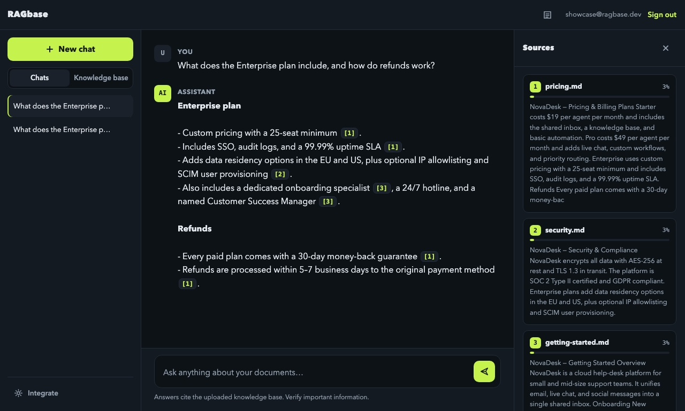
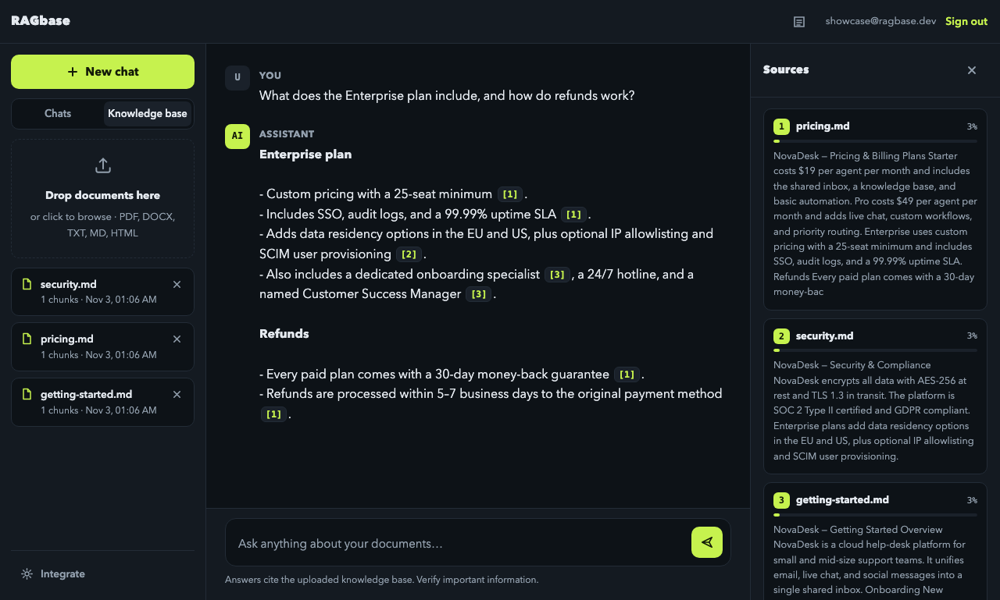
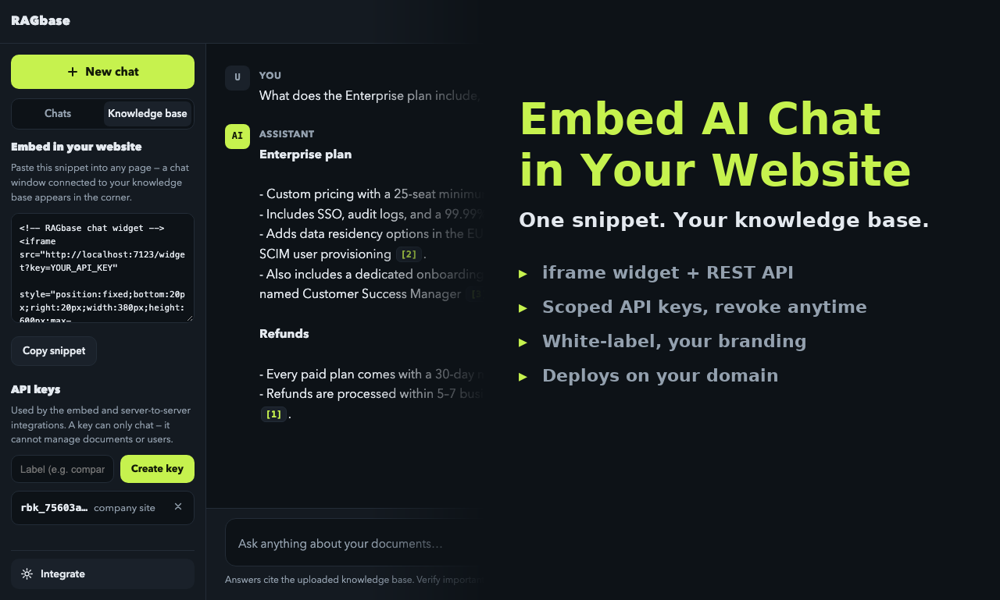

# RAGbase

**Chat with your documents. Every answer cites its sources.**

[English](README.md) · [简体中文](README.zh-CN.md)

RAGbase is a production-ready, self-hosted **RAG (retrieval-augmented generation)** web app.
Upload PDFs, DOCX, Markdown and more — then ask questions in natural language and get
streaming AI answers grounded **only in your knowledge base**, with numbered citations
linking back to the exact source passages.

No vector database. No build step. One process, one SQLite file.

[](https://www.python.org)
[](https://fastapi.tiangolo.com)
[](#tests)
[](LICENSE)



## Features

- 🔐 **Accounts & admin** — JWT auth, bcrypt hashing. The first registered account
  becomes admin; admins can reset any user's password.
- 📄 **Document ingestion** — PDF, DOCX, TXT, Markdown, HTML. Smart chunking with overlap,
  per-user quotas and upload-size limits.
- 🗂️ **File library** — the knowledge base is a gallery, not a list: grid or list view,
  search, sort, multi-select (shift-range, ⌘A, invert) and batch delete in one request.
  See [File library](#file-library).
- 🧠 **Hybrid retrieval** — vector embeddings fused with **BM25 lexical search via RRF**
  (Reciprocal Rank Fusion). Precise on keywords, robust on semantics. Per-document
  diversity caps and relevance thresholding keep answers on-topic.
- 🀄 **Chinese-first** — bilingual UI (zh/en, follows the browser language) and CJK
  **bigram** indexing, so 退款 no longer collides with 汇款 or 条款. See
  [Chinese support](#chinese-support).
- 💬 **Streaming chat** — token-by-token answers over SSE, per-user conversation history.
- 🎯 **Source citations** — numbered chips in every answer plus a relevance-scored sources
  panel showing the exact passages used.
- 🌐 **Website widget** — a floating iframe chat that embeds into any customer site with a
  copy-paste snippet, backed by scoped, revocable API keys (`rbk_…`, stored hashed).
- 🔌 **REST + SSE API** — server-to-server chat endpoint for custom front-ends.
- 🧪 **Demo mode** — runs fully offline without any API key (local extractive engine), so
  you can evaluate the entire product before plugging in a model.
- 🗄️ **Zero external services** — vectors live in SQLite as float32 blobs, searched with
  numpy cosine similarity; a per-user BM25 index stays in memory. Great for hundreds of
  documents; swap in Postgres + pgvector when you outgrow it.

## Quick start

```bash
git clone https://github.com/<you>/ragbase.git
cd ragbase
python3 -m venv .venv
source .venv/bin/activate          # Windows: .venv\Scripts\activate
pip install -r requirements.txt
cp .env.example .env               # fill in your LLM key (optional)
python run.py                      # serves on http://localhost:7100
```

Open http://localhost:7100, create an account, switch to the **Knowledge base** tab,
upload documents, and start chatting.

> **Prefer containers?** `docker compose up -d --build` gives you the same app on
> http://localhost:8000 with no local Python at all — see [Docker](#docker--one-command).

> **No LLM key?** The app runs in demo mode and still retrieves and quotes relevant
> passages — perfect for trying the product end to end. Endpoints without an embeddings
> API (e.g. DeepSeek) work out of the box: chat goes to the LLM, embeddings stay local,
> and BM25 keeps lexical search strong.

## Chinese support

Chinese ships as a first-class language, not an afterthought.

**Interface** — a dependency-free i18n layer (`app/static/i18n.js`) with `zh`/`en`
dictionaries. The UI follows `navigator.language` on first visit (Chinese browsers get
Chinese, English browsers stay English), the topbar button switches at runtime, and the
choice is remembered in `localStorage`. Dates format per UI language, so an English
interface never shows 11月4日. The embeddable widget is bilingual too, with
`?lang=zh` / `?lang=en` for per-customer defaults.

**Retrieval** — Chinese has no spaces, so without a dictionary you must pick a splitting
granularity. RAGbase indexes **character bigrams**:

| Text | Unigrams (old) | Bigrams (now) |
|---|---|---|
| `退款政策` | 退 / 款 / 政 / 策 | 退款 / 款政 / 政策 |
| query `退款` vs doc `汇款手续费` | matches (both contain 款) | no match |
| query `退款` vs doc `退款政策` | matches | matches |

Single-character runs stay as-is (`税` still works). The same tokenizer feeds both BM25
and the local feature-hash vectors, so both retrievers agree on vocabulary.

Demo vectors are hashes of those tokens, so changing the tokenizer moves the coordinate
space. On startup the app compares `meta.tokenizer_version` and re-embeds every chunk
in batches when it differs — no manual migration, no data loss. Deployments using a real
embedding API are unaffected (the provider owns the model).

**Answers** — the system prompt pins the reply language to the question's language while
keeping `[1]` citation markers intact; demo-mode fallbacks are bilingual; SSE streams
Chinese in small slices so it types out visibly instead of appearing in one dump.

## File library

A hundred files is a normal size for a knowledge base, and a hundred one-at-a-time deletes
is not. The old rail was a 264px column of rows with an × on each — fine for ten files,
unusable at fifty.

- **Grid or list** — six columns of tiles on a desktop, two on a phone. The list view trades
  the preview for aligned name / chunks / date columns. The choice is remembered per browser.
- **Selection** — click a tile, shift-click for a range, `⌘A` for everything, invert to flip
  the set, `Esc` to clear. The count follows the *filtered* grid: a search never leaves a
  delete aimed at a file you can no longer see.
- **Batch delete** — one confirmation, one request:

  ```http
  POST /api/documents/delete
  {"ids": ["doc_1", "doc_2"]}   →   {"deleted": 2, "requested": 2}
  ```

  Chunks and embeddings follow through the foreign-key cascade, so nothing is left behind
  that retrieval could still find. Ids you do not own simply do not match — a crafted body
  cannot be used to probe another account.
- **Upload with progress** — drop anywhere in the library, not on a small box. Files go up
  in batches of eight and the panel reports `12 / 100` with a per-file failure list, instead
  of greying the area out and hoping.

## Large knowledge bases

Six passages are the right amount of context for *"how long is the refund window"* and the
wrong amount for *"which people are in here"*. On a hundred-document base the old path
returned the six closest documents and the model reported them as the complete list — it
answered "the knowledge base contains 6 people" with a straight face.

Questions that sweep the collection are now detected before retrieval:

- **Listing intent** — `有哪些` / `列出` / `all` / `which` / `how many` … widens the net to
  `RAGBASE_LIST_TOP_K` (20) passages and allows **at most one chunk per document**, so 20
  slots cover 20 documents instead of 7.
- **A name in the question keeps it narrow.** "周星驰演过哪些电影" matches a filename, so it
  stays a single-document lookup instead of dragging the whole base into the prompt.
- **Corpus inventory** — the prompt also receives one line per document (filename plus the
  opening 60 characters, which usually states the category). That is what makes an exact
  "how many" and a complete list possible. Capped by `RAGBASE_INVENTORY_DOCS` and
  `RAGBASE_CONTEXT_CHARS`, so a ten-thousand-document base cannot blow up the prompt.

Measured on the 100 generated celebrity profiles in `test-pdf/` (one chunk each):

| Question | Before | After |
|---|---|---|
| 这个知识库里有哪些明星？ | 「知识库中收录了以下 6 位明星」 + 6 names | all 100, grouped by category |
| 有哪些女歌手 | 6 of 13 | all 13 |
| 周星驰演过哪些电影？（single lookup） | correct | unchanged, 100% recall@6 |

Single-name lookups were 92% top-1 / 100% recall@6 both before and after, so the widening
does not trade precision for coverage.

## Works with any OpenAI-compatible LLM

| Provider | Chat | Embeddings |
|---|---|---|
| OpenAI | ✅ | ✅ |
| DeepSeek | ✅ | local fallback (BM25 carries retrieval) |
| Groq / Together / vLLM / Ollama | ✅ | per provider |

Set `RAGBASE_LLM_BASE_URL`, `RAGBASE_LLM_API_KEY` and `RAGBASE_LLM_MODEL` in `.env`.
Everything else is automatic.



## Embed it in any website

Create an API key in the **Embed & API** tab, then drop one snippet into the customer's page:

```html
<iframe src="https://your-host/widget?key=rbk_..." style="position:fixed;bottom:20px;right:20px;width:380px;height:600px;border:none;z-index:9999;border-radius:16px;box-shadow:0 8px 30px rgba(0,0,0,.35);" title="Knowledge base chat"></iframe>
```

Or call the API directly (CORS enabled):

```bash
curl -X POST https://your-host/api/widget/chat \
  -H "X-API-Key: rbk_..." -H "Content-Type: application/json" \
  -d '{"message": "What is the refund policy?", "conversation_id": null}'
# → {"conversation_id": "...", "answer": "...", "sources": [...]}
```

Add `"stream": true` to the same endpoint to get the SSE stream the app itself uses —
one `data: {"delta": "…"}` frame per token, then a final
`data: {"done": true, "conversation_id": "...", "sources": [...]}`:

```bash
curl -N -X POST https://your-host/api/widget/chat \
  -H "X-API-Key: rbk_..." -H "Content-Type: application/json" \
  -d '{"message": "What is the refund policy?", "stream": true}'
```

For developers who would rather not maintain iframe markup, the same thing in one line:

```html
<script src="https://your-host/sdk.js" data-key="rbk_..." data-lang="zh"></script>
```

The SDK renders inside a shadow root (the host page's CSS cannot leak in), pulls the key's
configuration, and exposes `RAGbase.open()`, `RAGbase.close()` and `RAGbase.toggle()`.
Preview any key's look at `/demo?key=rbk_...`.

API keys are scoped to one knowledge base and can only chat — they cannot manage documents
or users. Revoke anytime from the **Embed & API** tab.

### Per-key customization

Each key carries its own branding, behaviour, scope and security policy, so one instance can
serve several customers without showing them each other's look or data. Edit it from the
pencil icon in the dashboard, or drive it from the API:

```bash
curl -X PATCH https://your-host/api/api-keys/KEY_ID \
  -H "Authorization: Bearer $TOKEN" -H "Content-Type: application/json" \
  -d '{
    "allowed_origins": ["customer.com", "*.customer.com"],
    "config": {
      "branding": {"theme": "light", "primaryColor": "#4f8cff", "title": "Acme Help",
                   "position": "left", "hideBranding": true},
      "behavior": {"autoOpen": "delay", "autoOpenDelay": 8,
                   "starterQuestions": ["Pricing?", "Refunds?"],
                   "fallbackMessage": "Please contact support@acme.com."},
      "content":  {"docIds": [], "quotaPerMin": 30, "quotaPerDay": 2000}
    }
  }'
```

`PATCH` deep-merges: send only the fields that change.

| Group | Options |
|---|---|
| `branding` | `theme` auto/light/dark · `primaryColor` (#rgb or #rrggbb) · `title` · `subtitle` · `greeting` · `placeholder` · `position` right/left · `icon` chat/spark/logo + `logoUrl` · `hideBranding` (Pro) |
| `behavior` | `autoOpen` never/delay/always + `autoOpenDelay` · `starterQuestions` (max 4) · `showSources` · `persistSession` · `fallbackMessage` |
| `content` | `docIds` (empty = entire knowledge base) · `quotaPerMin` · `quotaPerDay` (0 = unlimited) |

Every value is rebuilt from an allow-list before it is stored: colours must be hex, enums fall
back to their default, text is trimmed and length-capped, URLs must be http(s). A malformed
config degrades to the default instead of breaking the embed or opening an injection path.

### Security: the key is public, the domain list is not

An embed key is printed in the customer's HTML, so it cannot be treated as a secret. Two
mechanisms take its place:

- **`allowed_origins`** — the key only answers approved domains. Browser calls get a 403
  without a CORS grant, and `/widget` returns `Content-Security-Policy: frame-ancestors …`, so
  browsers refuse to render the widget on any other site. Server-to-server calls (no `Origin`
  header) still pass: holding the key is what authorises those.
- **Quota** — `quotaPerMin` / `quotaPerDay` cap a runaway client; a 429 comes back with
  `Retry-After`. Counters live in process memory and reset on restart.

An empty `allowed_origins` keeps the permissive behaviour of earlier versions — set it before
handing a key to a third party.

### White label is a paid capability

`hideBranding` only takes effect on a key whose plan is `pro`; on `free` it is silently ignored
and automatically restored if the key is upgraded again. Only an admin can move a key to `pro`:

```bash
curl -X PATCH https://your-host/api/admin/api-keys/KEY_ID/plan \
  -H "Authorization: Bearer $ADMIN_TOKEN" -H "Content-Type: application/json" \
  -d '{"plan": "pro"}'
```



## Configuration

All settings live in `.env` (see [.env.example](.env.example)):

| Variable | Default | Purpose |
|---|---|---|
| `RAGBASE_LLM_API_KEY` | — | Enables the real LLM. Any OpenAI-compatible endpoint works via `RAGBASE_LLM_BASE_URL`. Legacy `OPENAI_API_KEY`/`OPENAI_BASE_URL` are also honoured. |
| `RAGBASE_LLM_BASE_URL` | `https://api.openai.com/v1` | Chat endpoint |
| `RAGBASE_LLM_MODEL` | `gpt-4o-mini` | Chat model (e.g. `deepseek-chat`) |
| `RAGBASE_EMBEDDING_API_KEY` | — | Embeddings. Leave empty for local feature-hash vectors + BM25. |
| `RAGBASE_JWT_SECRET` | — | **Change in production** |
| `RAGBASE_ALLOW_REGISTRATION` | `true` | Set `false` to make the instance invite-only |
| `RAGBASE_MAX_DOCS_PER_USER` | `0` (unlimited) | Per-user document cap |
| `RAGBASE_MAX_UPLOAD_MB` | `25` | Upload size limit per file |
| `RAGBASE_CHUNK_SIZE` / `RAGBASE_CHUNK_OVERLAP` | `900` / `150` | Chunking parameters |
| `RAGBASE_TOP_K` | `6` | Retrieved passages per question |
| `RAGBASE_LIST_TOP_K` | `20` | Passages for a corpus-wide question; `0` disables widening and the inventory |
| `RAGBASE_INVENTORY_DOCS` | `200` | Documents listed in the prompt's corpus inventory |
| `RAGBASE_CONTEXT_CHARS` | `24000` | Retrieved characters per answer, inventory included |
| `RAGBASE_DATA_DIR` | `data` | SQLite database location |

## Docker — one command

```bash
git clone https://github.com/<you>/ragbase.git && cd ragbase
docker compose up -d --build
# → http://localhost:8000
```

That is the whole install. No Python, no venv, no `.env` needed: with no API key the
container boots in demo mode, so you can register, upload a PDF and get cited answers
immediately. Add a key later and restart — nothing else changes.

Or use the launcher, which also creates `.env` on first run, waits for the health check
and prints the URL:

```bash
./docker.sh                 # build + start + wait until healthy
./docker.sh logs            # follow logs
./docker.sh restart         # rebuild and restart, data kept
./docker.sh stop            # stop, data kept
./docker.sh destroy         # wipe container + data volume
./docker.sh reset-password user@example.com newpass
```

| File | Purpose |
|---|---|
| `Dockerfile` | Python 3.12-slim, non-root (`uid 10001`), `HEALTHCHECK` on `/api/health` |
| `docker-compose.yml` | Port, env vars, named `ragbase-data` volume, log rotation |
| `docker-entrypoint.sh` | Auto-generates a persistent `RAGBASE_JWT_SECRET`, fixes volume ownership, drops root |
| `.dockerignore` | Keeps `.venv`, local `data/`, screenshots and media out of the image (≈6 KB of build context vs. 40 MB) |
| `.env.example` | Every supported variable, documented |

**Configure it** — edit `.env` (copy from `.env.example`) and `docker compose up -d`:

```ini
RAGBASE_PORT=8000                       # host port
RAGBASE_LLM_API_KEY=sk-...              # leave empty for demo mode
RAGBASE_LLM_BASE_URL=https://api.deepseek.com/v1
RAGBASE_LLM_MODEL=deepseek-chat
RAGBASE_ALLOW_REGISTRATION=false        # invite-only after you create the admin
```

**Keep data in a visible folder** instead of a named volume — swap the volume line in
`docker-compose.yml`:

```yaml
    volumes:
      - ./data:/app/data
```

**Plain `docker run`**, if you prefer no compose:

```bash
docker build -t ragbase .
docker run -d --name ragbase -p 8000:8000 --restart unless-stopped \
  --env-file .env -v ragbase-data:/app/data ragbase
```

**Backup / restore** — the instance is one SQLite file inside the volume:

```bash
docker run --rm -v ragbase-data:/data -v "$PWD":/backup alpine \
  tar czf /backup/ragbase-backup.tar.gz -C /data .
```

The container is stateless apart from `/app/data`; `docker compose down` (without `-v`)
never touches your documents.

**Any VPS** — behind nginx/Caddy with HTTPS:

```ini
[Service]
WorkingDirectory=/opt/ragbase
EnvironmentFile=/opt/ragbase/.env
ExecStart=/opt/ragbase/.venv/bin/python run.py --host 127.0.0.1 --port 7100
Restart=always
```

## Tests

The suite is hermetic: `tests/conftest.py` pins the environment **before** the app is
imported, so pytest always boots in demo mode against a throwaway SQLite database.
No LLM key, no network, and your `data/` folder is never touched.

```bash
pip install -r requirements-dev.txt
pytest                                        # 326 tests, ~45s
pytest --cov=app --cov-report=term-missing    # 99% coverage of app/
```

| Area | File |
|---|---|
| Config, `.env` parsing, mode switches | `tests/test_config.py` |
| bcrypt hashing, JWT, email validation | `tests/test_auth_unit.py` |
| SQLite layer: users, documents, chunks, API keys, conversations, cascades | `tests/test_database.py` |
| Parsing & chunking (txt, md, html, docx, pdf) | `tests/test_ingest.py` |
| Demo engine, OpenAI-compatible chat/embeddings, tokenizer & vector migration | `tests/test_providers.py` |
| BM25 scoring, index caching, per-user isolation, Chinese queries | `tests/test_bm25.py` |
| Retrieval, RRF fusion, prompt assembly, answers | `tests/test_rag.py` |
| HTTP: auth, documents, SSE chat, conversations, API keys & widget, admin, static/CORS | `tests/test_api_*.py` |
| Ops CLI (`python -m app.tools`) | `tests/test_tools_cli.py` |

## Architecture

```
ragbase/
├── run.py                  # entry point
├── app/
│   ├── main.py             # FastAPI routes: auth, documents, chat (SSE), admin
│   ├── config.py           # env-driven settings
│   ├── database.py         # SQLite: users, docs, chunks(+vectors), conversations
│   ├── auth.py             # JWT + bcrypt
│   ├── ingest.py           # parsing (pdf/docx/txt/md/html) + chunking
│   ├── bm25.py             # per-user lexical index, cached in memory
│   ├── providers.py        # OpenAI / demo providers, zh/en tokenizer, vector migration
│   ├── rag.py              # retrieval, RRF fusion, prompt building, cited answering
│   └── tools.py            # ops CLI
└── app/static/             # frontend (vanilla JS, no build): i18n.js, app.js, styles.css
```

## Operations

```bash
python -m app.tools reset-password user@example.com newpassword   # works even if admin is locked out
python -m app.tools create-user user@example.com password [--admin]
python -m app.tools list-users
```

## Customization

- **Branding:** app name and logo in `app/static/index.html`; colors are CSS custom
  properties at the top of `app/static/styles.css`.
- **Copy & languages:** `I18N.en` / `I18N.zh` in `app/static/i18n.js` — add a dictionary
  to add a language.
- **Persona:** edit `SYSTEM_PROMPT` in `app/rag.py`.
- **Retrieval quality:** tune `RAGBASE_TOP_K`, threshold, and chunk size via `.env`;
  CJK granularity lives in `providers._cjk_tokens()` (bump `TOKENIZER_VERSION` after
  changing it — vectors are rebuilt on the next start).

## License

[MIT](LICENSE) — use it, ship it, rebrand it, sell it to your customers.
