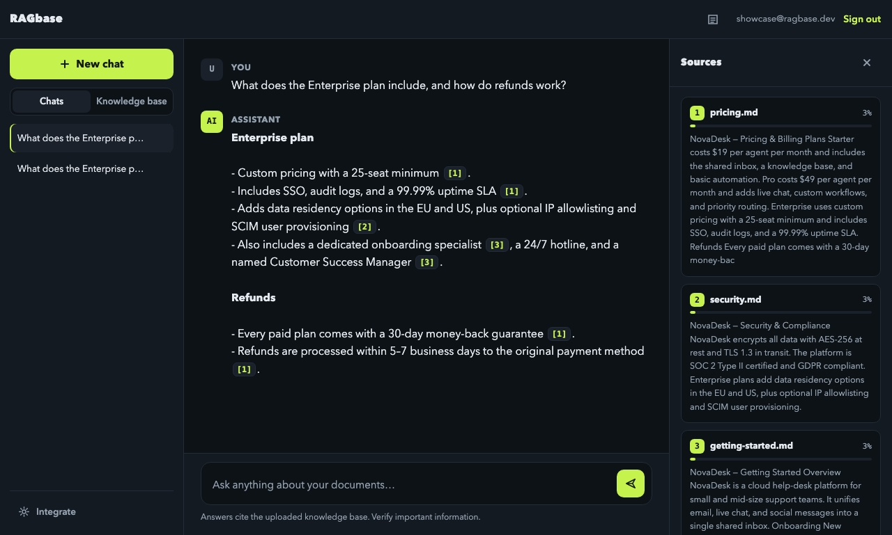
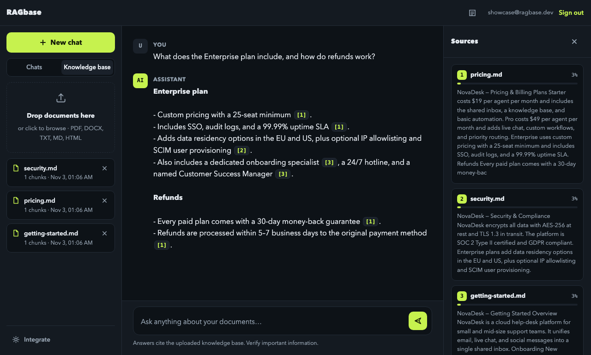
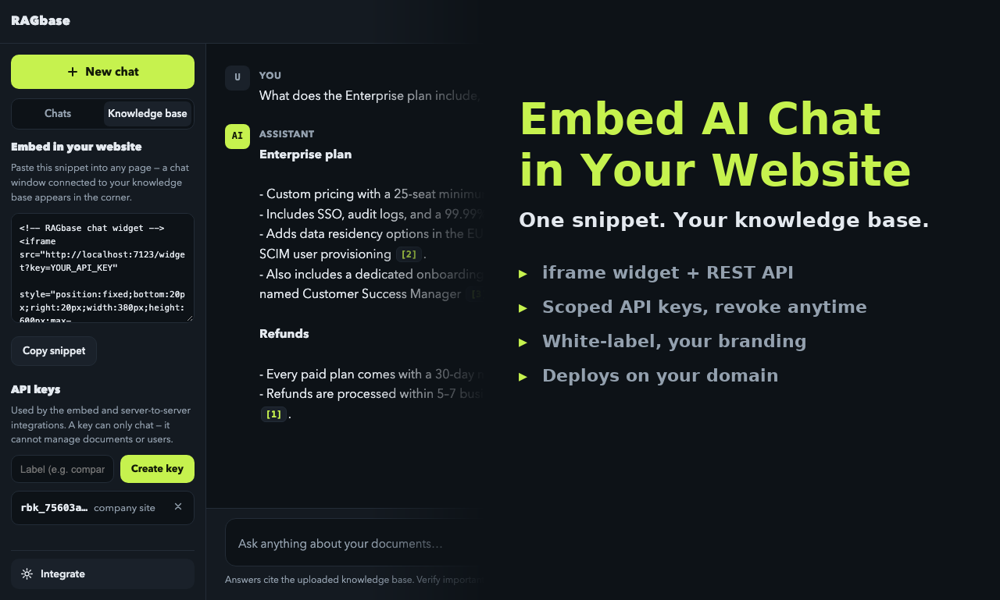

# RAGbase

**和你的文档对话。每个回答都标注来源。**

[English](README.md) · [简体中文](README.zh-CN.md)

RAGbase 是一个生产可用的**自托管 RAG（检索增强生成）**应用。上传 PDF、DOCX、Markdown
等文档，用自然语言提问，得到**只基于你的知识库**的流式回答，并附带编号引用，可以直接
跳回原文段落。

不需要向量数据库，不需要前端构建，一个进程、一个 SQLite 文件。



## 特性

- 🔐 **账号与管理员** —— JWT 认证、bcrypt 加密。首个注册的账号自动成为管理员，管理员可重置任意用户密码。
- 📄 **文档入库** —— PDF、DOCX、TXT、Markdown、HTML；按语义边界分块并保留重叠，支持按用户配额与上传大小限制。
- 🧠 **混合检索** —— 向量检索与 **BM25 词法检索经 RRF 融合**（Reciprocal Rank Fusion），关键词精准、语义稳健；带单文档多样性上限与相关度阈值。
- 🀄 **中文优先** —— 界面中英双语（按浏览器语言自动切换），中文按**二元组（bigram）**切分建立索引，`退款` 不会命中 `汇款`、`条款`。详见[中文支持](#中文支持)。
- 💬 **流式对话** —— SSE 逐字输出，按用户保存会话历史；中文按小片段推送，不会整段一次性出现。
- 🎯 **来源引用** —— 回答中带编号角标，右侧来源面板显示具体段落与相关度。
- 🌐 **网站挂件** —— 一段 `<iframe>` 即可嵌入任意网站，背后是可吊销、按知识库隔离的 API 密钥（`rbk_…`，仅存哈希）。
- 🔌 **REST + SSE API** —— 服务端对接自有前端的聊天接口。
- 🧪 **演示模式** —— 不填任何 API Key 也能完整跑通（本地抽取式引擎），先评估再接入模型。
- 🗄️ **零外部依赖** —— 向量以 float32 blob 存在 SQLite 里，用 numpy 做余弦相似度；每个用户的 BM25 索引驻留内存。适合数百份文档，规模变大时可替换为 Postgres + pgvector。

## 快速开始

```bash
git clone https://github.com/charleslck/rag-base.git
cd rag-base
python3 -m venv .venv
source .venv/bin/activate          # Windows: .venv\Scripts\activate
pip install -r requirements.txt
cp .env.example .env               # 填 LLM Key（可选）
python run.py                      # http://localhost:7100
```

打开 http://localhost:7100，注册账号，切到「知识库」标签上传文档，然后开始提问。

> **没有 LLM Key？** 应用会进入演示模式，依然能检索并引用原文段落，适合完整试用。
> 不提供 embedding 接口的模型（如 DeepSeek）开箱即用：对话走 LLM，向量在本地计算，
> BM25 保证词法检索质量。

> **更想用容器？** `docker compose up -d --build` 即可在 http://localhost:8000 跑起来，
> 本机完全不需要 Python，见 [Docker 一键启动](#docker-一键启动)。

## Docker 一键启动

```bash
git clone https://github.com/charleslck/rag-base.git && cd rag-base
docker compose up -d --build
# → http://localhost:8000
```

就这一条命令。不需要 Python、不需要虚拟环境、也不需要 `.env`：没有 API Key 时容器自动
进入演示模式，注册、上传 PDF、拿到带引用的回答，立刻可用。之后想接真模型，填好
`.env` 重启即可，其他都不用改。

也可以使用启动脚本，它会自动创建 `.env`、等健康检查通过、打印访问地址：

```bash
./docker.sh                 # 构建 + 启动 + 等健康检查
./docker.sh logs            # 跟踪日志
./docker.sh restart         # 重新构建并重启，数据保留
./docker.sh stop            # 停止，数据保留
./docker.sh destroy         # 删除容器与数据卷
./docker.sh reset-password user@example.com newpass
```

| 文件 | 作用 |
|---|---|
| `Dockerfile` | Python 3.12-slim，非 root 运行（uid 10001），内置 `/api/health` 健康检查 |
| `docker-compose.yml` | 端口、环境变量、命名卷 `ragbase-data`、日志轮转 |
| `docker-entrypoint.sh` | 首次启动自动生成并持久化 `RAGBASE_JWT_SECRET`，修正数据卷权限后降权 |
| `.dockerignore` | 把 `.venv`、本地 `data/`、截图和视频挡在镜像外（构建上下文从 40MB 降到几 KB） |
| `.env.example` | 所有可配置项，逐项注释 |

**配置**：复制 `.env.example` 为 `.env`，改完 `docker compose up -d` 生效。

```ini
RAGBASE_PORT=8000                       # 宿主机端口
RAGBASE_LLM_API_KEY=sk-...              # 留空即演示模式
RAGBASE_LLM_BASE_URL=https://api.deepseek.com/v1
RAGBASE_LLM_MODEL=deepseek-chat
RAGBASE_ALLOW_REGISTRATION=false        # 建好管理员后关闭注册
```

**数据放到可见目录**：把 `docker-compose.yml` 里的卷换成：

```yaml
    volumes:
      - ./data:/app/data
```

**不想用 compose**：

```bash
docker build -t ragbase .
docker run -d --name ragbase -p 8000:8000 --restart unless-stopped \
  --env-file .env -v ragbase-data:/app/data ragbase
```

**备份 / 恢复** —— 整个实例就是数据卷里的一个 SQLite 文件：

```bash
docker run --rm -v ragbase-data:/data -v "$PWD":/backup alpine \
  tar czf /backup/ragbase-backup.tar.gz -C /data .
```

容器除 `/app/data` 外无状态；`docker compose down`（不带 `-v`）不会动你的文档。

## 中文支持

### 界面

前端零依赖的 i18n 层（`app/static/i18n.js`），中英双语：

- 默认跟随浏览器语言：`navigator.language` 为 `zh-*` 进中文，其余进英文，海外访客不受影响；
- 顶栏右侧（登录页底部同款）可手动切换，选择写入 `localStorage`，下次记住；
- 日期时间跟随界面语言格式化，不会出现「英文界面里冒出 11月4日」；
- 聊天挂件同样支持，还可用 `?lang=zh` / `?lang=en` 强制指定，便于按客户站群区分。

### 检索

中文没有空格，不引入词典就要自己决定切分粒度。RAGbase 用**字符二元组**：

| 文本 | 单字切分（旧） | 二元组（现在） |
|---|---|---|
| `退款政策` | 退 / 款 / 政 / 策 | 退款 / 款政 / 政策 |
| 查询 `退款` 是否命中 `汇款手续费` | 命中（都含「款」） | 不命中 |
| 查询 `退款` 是否命中 `退款政策` | 命中 | 命中 |

单条 CJK 长串只有一个字时保留单字（`税` 依然可用）。这套 token 同时用于 BM25 与
本地 feature-hash 向量，所以两者口径一致。

**升级迁移**：本地向量的维度来自 token 的哈希，换分词器等于换坐标系。应用启动时会比对
`meta.tokenizer_version`，不一致就自动重算全部 chunk 向量（分批提交），无需手动操作、
也不会丢数据。使用真实 embedding API 时不受影响（那是模型侧的事）。

### 回答

- System prompt 明确要求「用提问的语言作答，`[1]` 引用格式保持原样」，中文提问得到中文回答并保留引用；
- 演示模式的兜底文案、无命中提示、加载提示均已双语化，不会出现英文兜底；
- SSE 流式输出按中文小片段推送，观感与英文逐词输出一致。

## 兼容任意 OpenAI 协议模型

| 提供方 | 对话 | 向量 |
|---|---|---|
| OpenAI | ✅ | ✅ |
| DeepSeek | ✅ | 本地兜底（BM25 承担检索） |
| Groq / Together / vLLM / Ollama | ✅ | 视提供方而定 |

在 `.env` 里设置 `RAGBASE_LLM_BASE_URL`、`RAGBASE_LLM_API_KEY`、`RAGBASE_LLM_MODEL`
即可，其余自动生效。



## 嵌入到任意网站

在「嵌入集成」里创建 API 密钥，然后把这段代码贴到客户页面：

```html
<iframe src="https://your-host/widget?key=rbk_..." style="position:fixed;bottom:20px;right:20px;width:380px;height:600px;border:none;z-index:9999;border-radius:16px;box-shadow:0 8px 30px rgba(0,0,0,.35);" title="Knowledge base chat"></iframe>
```

也可以直接调 API（已开启 CORS）：

```bash
curl -X POST https://your-host/api/widget/chat \
  -H "X-API-Key: rbk_..." -H "Content-Type: application/json" \
  -d '{"message": "退款政策是什么？", "conversation_id": null}'
# → {"conversation_id": "...", "answer": "...", "sources": [...]}
```

密钥只绑定一个知识库且只能对话，不能管理文档或用户，随时可在「嵌入集成」中吊销。
挂件页面（`app/static/widget.html`）是自包含的，标题、问候语、配色都便于按客户二次定制；
要改默认语言，加 `?lang=zh` 或改 `STR` 字典。



## 配置项

所有配置都在 `.env`（见 [.env.example](.env.example)）：

| 变量 | 默认值 | 说明 |
|---|---|---|
| `RAGBASE_LLM_API_KEY` | — | 填入即启用真实 LLM；任意 OpenAI 协议端点，通过 `RAGBASE_LLM_BASE_URL` 指定。旧版 `OPENAI_API_KEY` / `OPENAI_BASE_URL` 同样生效 |
| `RAGBASE_LLM_BASE_URL` | `https://api.openai.com/v1` | 对话端点 |
| `RAGBASE_LLM_MODEL` | `gpt-4o-mini` | 对话模型（如 `deepseek-chat`） |
| `RAGBASE_EMBEDDING_API_KEY` | — | 向量接口。留空则用本地 feature-hash 向量 + BM25 |
| `RAGBASE_JWT_SECRET` | — | **生产环境务必更换**；Docker 下留空会自动生成并持久化 |
| `RAGBASE_ALLOW_REGISTRATION` | `true` | 设为 `false` 后仅限邀请 |
| `RAGBASE_MAX_DOCS_PER_USER` | `0`（不限） | 每用户文档上限 |
| `RAGBASE_MAX_UPLOAD_MB` | `25` | 单文件大小上限 |
| `RAGBASE_CHUNK_SIZE` / `RAGBASE_CHUNK_OVERLAP` | `900` / `150` | 分块参数（字符数，中英通用） |
| `RAGBASE_TOP_K` | `6` | 每次提问召回的段落数 |
| `RAGBASE_DATA_DIR` | `data` | SQLite 位置 |

## 部署

**任意 VPS** —— 用 nginx / Caddy 加 HTTPS：

```ini
[Service]
WorkingDirectory=/opt/ragbase
EnvironmentFile=/opt/ragbase/.env
ExecStart=/opt/ragbase/.venv/bin/python run.py --host 127.0.0.1 --port 7100
Restart=always
```

反代注意：SSE 需要关闭缓冲（nginx `proxy_buffering off;`），否则流式回答会「憋着」一次性返回。

## 测试

测试套件是隔离的：`tests/conftest.py` 在导入应用**之前**就固定好环境变量，因此 pytest
永远跑在演示模式 + 临时 SQLite 上，不碰你的 `data/`，也不需要网络。

```bash
pip install -r requirements-dev.txt
pytest                                        # 326 个测试，约 45 秒
pytest --cov=app --cov-report=term-missing    # 覆盖率
```

| 范围 | 文件 |
|---|---|
| 配置、`.env` 解析、模式切换 | `tests/test_config.py` |
| bcrypt、JWT、邮箱校验 | `tests/test_auth_unit.py` |
| SQLite 层：用户、文档、chunk、密钥、会话、级联删除 | `tests/test_database.py` |
| 解析与分块（txt / md / html / docx / pdf） | `tests/test_ingest.py` |
| 演示引擎 + OpenAI 协议对接 + 分词/向量迁移 | `tests/test_providers.py` |
| BM25 打分、索引缓存、用户隔离、中文查询 | `tests/test_bm25.py` |
| 检索、RRF 融合、prompt 组装、回答 | `tests/test_rag.py` |
| HTTP：认证、文档、SSE 对话、会话、密钥与挂件、管理、静态资源与 CORS | `tests/test_api_*.py` |
| 运维 CLI（`python -m app.tools`） | `tests/test_tools_cli.py` |

## 架构

```
ragbase/
├── run.py                  # 入口
├── app/
│   ├── main.py             # FastAPI 路由：认证、文档、对话（SSE）、管理、健康检查
│   ├── config.py           # 环境变量配置
│   ├── database.py         # SQLite：用户、文档、chunk（含向量）、会话、meta
│   ├── auth.py             # JWT + bcrypt
│   ├── ingest.py           # 解析（pdf/docx/txt/md/html）+ 分块
│   ├── bm25.py             # 每用户词法索引，内存缓存
│   ├── providers.py        # OpenAI / 演示引擎（向量 + 对话）、中英分词、向量迁移
│   ├── rag.py              # 检索、RRF 融合、prompt 组装、带引用回答
│   └── tools.py            # 运维 CLI
└── app/static/             # 前端（原生 JS，无构建）：i18n.js、app.js、styles.css
```

## 运维

```bash
python -m app.tools reset-password user@example.com newpassword   # 管理员被锁也能用
python -m app.tools create-user user@example.com password [--admin]
python -m app.tools list-users
```

## 二次开发

- **品牌**：应用名与 logo 在 `app/static/index.html`；配色是 `app/static/styles.css` 顶部的 CSS 变量。
- **文案 / 语言**：`app/static/i18n.js` 的 `I18N.en` / `I18N.zh` 字典，加语言即加一份字典。
- **人设**：改 `app/rag.py` 里的 `SYSTEM_PROMPT`。
- **检索质量**：通过 `.env` 调 `RAGBASE_TOP_K`、阈值、分块大小；中文分词粒度在
  `app/providers.py` 的 `_cjk_tokens()`（改完记得递增 `TOKENIZER_VERSION`，启动时会自动重建向量）。

## 许可

[MIT](LICENSE) —— 可自用、可上线、可改品牌、可卖给客户。
